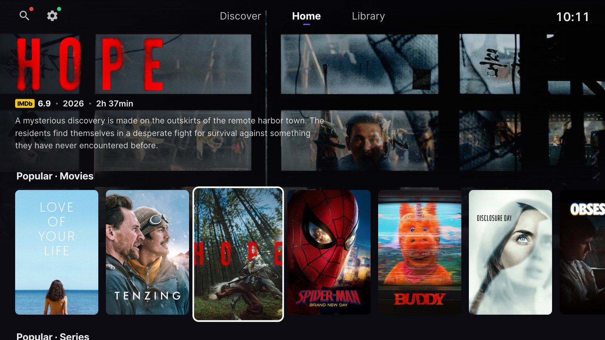

# StremioBrew

An unofficial, Stremio-compatible client for **older, rooted LG webOS TVs** (webOS 3 and later),
built for the generation the official Stremio app doesn't support.

*Stremio™ is a trademark of Smart Code UG. This project is not affiliated with, endorsed by
or sponsored by Stremio; the name only describes compatibility.*

**Website:** https://simussu9-wq.github.io/stremiobrew/



You bring your own **Stremio account** and your own **addons**. The app ships empty and hosts
or indexes nothing: it plays only the stream links your installed addons return, and keeps your
library and watched history in sync with your Stremio account.

## Features

- Home, Discover, Library and Search from your addons, with artwork, logos and trailers
- Debrid playback, and P2P playback through a bundled torrent engine whose buffer sizes itself
  to the TV's free storage
- Player with episodes, sources, subtitles, audio and picture-size trays, skip intro / recap /
  credits, and a next-episode card
- Embedded and external subtitles, subtitle styling, and one-press subtitle auto-sync
- Library, watched state and Continue Watching synced with your Stremio account
- 11 languages, including full right-to-left Arabic; optional titles, descriptions and posters
  in your language from TMDB (with your own free TMDB key)
- Type searches and share logs from your phone (QR code, local network only)

## Requirements

- An LG TV running **webOS 3.0 or later**, **rooted**, with the **Homebrew Channel** installed
- 32-bit ARM (armv7) userland — the bundled binaries are 32-bit ARM
- A Stremio account and your own addons (a debrid service gives the smoothest playback)

Built and tested on webOS 4.4 (one model so far); webOS 3 and 5+ should work but are untested.
See [docs/compatibility.md](docs/compatibility.md) for the details per version.

## Install

In the Homebrew Channel: **Settings → Add repository**, enter

```
https://simussu9-wq.github.io/stremiobrew/apps.json
```

then find **StremioBrew** in the list and install it.

### Coming from the old version (`io.strem.tv.beta`)

The app now has its own ID (`tv.stremiobrew.app`), so the TV treats it as a new app: install
StremioBrew from the list, then remove the old one from the TV's app list. Your library,
watched history and addons come back when you sign in, because they live in your Stremio account.

## Updates

Releases are published to the repository above. The Homebrew Channel shows **Update** on
StremioBrew whenever a newer version is out.

## Privacy

- Sign-in goes directly to Stremio's API; your account data stays on the TV.
- The app collects no analytics and sends nothing to the developer.
- Error logs stay on the TV. Settings → Support → Share logs shows a QR code so **you** can
  open them on your phone; nothing is uploaded automatically.
- The helper service only answers the app itself (requests from websites are refused).

## Licences

StremioBrew's own code (`app/`, `service/`, `tools/`) is licensed under the
**GNU General Public License v3.0 or later** — see [LICENSE](LICENSE).

The package also bundles third-party components under their own licences, listed with their
sources in `service/licenses/README.txt`: ffmpeg (LGPL-2.1+), zlib, nuvio-engine (GPL-3.0+),
libtorrent (BSD-3-Clause), Boost headers (BSL-1.0), the Mozilla CA bundle (MPL-2.0), a QR code
generator (MIT), and the Inter and Noto Sans Arabic fonts (OFL-1.1; the Arabic one resized).

Provided as is, for personal use on hardware you own.
